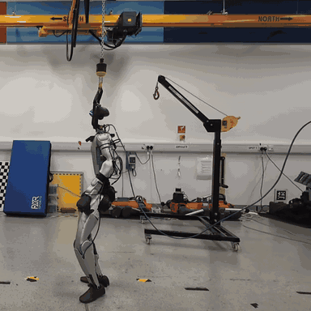
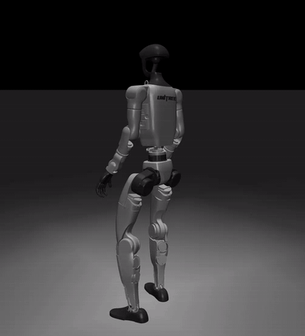
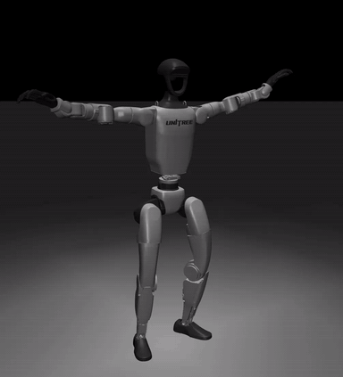

# SuperMimic G1 Deployment
**Unofficial** deployment code for SuperMimic. The policy was trained using [SuperMimic-Reproduced (MIT-licensed)](https://github.com/CuboiLeo/SuperMimic-Reproduced/blob/main/LICENSE).

Run a pretrained motion policy in MuJoCo or on a **29-DoF Unitree G1**.

## Deployment demos

| Real G1 deployment | MuJoCo demo 1 | MuJoCo demo 2 |
| --- | --- | --- |
|  |  |  |

## 1. Install

Use Linux with internet access. On Ubuntu/Debian:

```bash
sudo apt-get update
sudo apt-get install -y python3 python3-pip git cmake build-essential
git clone https://github.com/KyrieYoung926/supermimic_deploy.git
cd supermimic_deploy
git clone https://github.com/unitreerobotics/unitree_sdk2_python.git
git -C unitree_sdk2_python checkout 814556d15970dd2ecf1c9984e845ca02ab07e206
bash setup.sh
```

Change the `cd` path if you placed the project elsewhere. Setup prepares Python 3.12 in `.venv`, installs all dependencies for motion download, conversion, simulation, and real-robot deployment, and builds CycloneDDS. It installs a project-local `uv` if needed. You do not need to activate `.venv`.

## 2. Get the deployment assets

Download `policy.onnx` and generate the motion references as described below:

```text
supermimic_deploy/
├── setup.sh
├── run_mujoco.sh
├── run.sh
└── assets/
    ├── config.json       # Joint parameters, motion list, and policy hash
    ├── policy.onnx       # Exported policy
    ├── motions/          # Processed reference clips (*.npz)
    └── robot/            # G1 XML and meshes
```

The current policy uses iteration **180000** and **40 processed motion clips**.

- **Policy ONNX:** download `policy.onnx` from [Google Drive](https://drive.google.com/drive/folders/1c8pdlvFXPxH9Bys2G5XvkD0AF7bZ8QCy?usp=drive_link) and save it as `assets/policy.onnx`. Use the 180000-step export matching the SHA-256 in `assets/config.json`.
- **Configuration and robot:** `assets/config.json` and `assets/robot/` are included in this repository.
- **Motion source:** [lvhaidong/LAFAN1_Retargeting_Dataset — `g1/`](https://huggingface.co/datasets/lvhaidong/LAFAN1_Retargeting_Dataset/tree/main/g1). Download and process its 40 CSV clips with the commands below.

All commands below use the same `.venv` created by `setup.sh`. Motion preparation does not require a training checkpoint.

### Download the source motion data

From the deployment repository root, download only the G1 CSV files (about 90 MB):

```bash
.venv/bin/python - <<'PYTHON'
from huggingface_hub import snapshot_download

snapshot_download(
    repo_id="lvhaidong/LAFAN1_Retargeting_Dataset",
    repo_type="dataset",
    allow_patterns=["g1/*.csv"],
    local_dir="data/raw/lafan1",
)
PYTHON
```

The downloaded files are in **`data/raw/lafan1/g1/`**, for example
`data/raw/lafan1/g1/walk1_subject1.csv`.

Convert the downloaded 30 Hz CSVs into the 50 Hz deployment references:

```bash
.venv/bin/python scripts/prepare_motions.py \
  --input-dir data/raw/lafan1/g1 --assets assets
```

This creates all 40 `assets/motions/*.npz` files, including the policy's 68-dimensional
reference features and the root state needed by MuJoCo. No separate asset bundle
or training installation is required. The conversion implementation is adapted
from SuperMimic-Reproduced; its MIT notice is in `scripts/LICENSE-SuperMimic-Reproduced`.

## 3. Run in MuJoCo

A graphical desktop with working OpenGL is required.

```bash
bash run_mujoco.sh --motion walk1_subject1
```

Click inside the viewer, then press **Enter**. The simulation waits at the first frame until you start it.

| Key | Action |
| --- | --- |
| Enter | Start the selected motion. |
| `[` / `]` | Previous / next motion; reset the full simulated pose. |
| Space | Align joints to the first frame; press Enter after alignment. |
| Backspace | Stop and freeze the simulation. |
| Close window | Exit. |

A motion plays once. To replay it or recover after a fall, press `]` then `[` to reset the same motion. Space only aligns joints; it does not reset the root pose.

## 4. Run on the real G1

**Real-robot deployment is at your own risk. You are responsible for assessing and validating its safety for your hardware and environment. The maintainer accepts no responsibility for injuries, damage, or losses resulting from deployment.**

Use a support or harness for initial tests. Verify joint directions, pelvis IMU directions, and an independent emergency stop.
Connect wired Ethernet to the robot. Find the interface name with:

```bash
ip -br addr
```

Configure that interface for your robot's network. Replace `enp0s31f6` below with its actual name, and stop any other low-level controller.

**Starting this program releases the existing motion service and sends damping commands. Damping does not hold the robot upright.**

```bash
bash run.sh --interface enp0s31f6 --robot g1-29dof --motion walk1_subject1
```

Use the **Unitree wireless remote**:

1. Wait for `DAMPING` in the terminal.
2. Press **Start** to align the joints to the first frame (3 seconds by default).
3. Wait for `holding first frame`, then release and press **A** to run.
4. Press **B** at any time to stop in damping.

| Input | Action |
| --- | --- |
| Start | Align to the first frame, then hold. |
| A | Start playback after alignment and pose checks. |
| B | Stop in damping (`kp=0`, `kd=2`); highest priority. |
| X / Y | Previous / next motion, **only in damping**. Release B before pressing X or Y. |
| Ctrl+C | Attempt to send damping for 0.5 seconds, then exit. |

After switching, check the printed motion name and repeat **Start → wait → A**. Switching does not reposition the real robot or reset its velocity. Choose a motion compatible with its supported pose.

### If A does not start

Release A and press it again after alignment completes. The terminal reports the largest joint error and the gravity direction error if the pose check fails. Default limits are **0.15 rad** per joint and **0.35** for the gravity-vector difference norm (dimensionless).

To explicitly skip these two pose checks during supported testing:

```bash
bash run.sh --interface enp0s31f6 --robot g1-29dof \
  --motion walk1_subject1 --skip-start-pose-check
```

## Acknowledgements

We thank the authors and maintainers of:

- [SuperMimic](https://supermimic.github.io/) for the original paper and method.
- [SuperMimic-Reproduced](https://github.com/CuboiLeo/SuperMimic-Reproduced) for the independent reproduction and training implementation used for this deployment workflow.
- [lvhaidong / LAFAN1_Retargeting_Dataset](https://huggingface.co/datasets/lvhaidong/LAFAN1_Retargeting_Dataset) for making the G1-retargeted LAFAN1 motion dataset publicly available. This deployment uses its 40 G1 clips as reference motions.
- [Ubisoft La Forge / LAFAN1](https://github.com/ubisoft/ubisoft-laforge-animation-dataset) for the original motion data and *Robust Motion In-Betweening* (Harvey et al., 2020).
- [mjlab](https://github.com/mujocolab/mjlab) and [Unitree Robotics](https://github.com/unitreerobotics) for simulation and robot software/assets.

## Licensing and redistribution

- **Code:** this repository's deployment code is [MIT-licensed](LICENSE). Portions derived from SuperMimic-Reproduced retain the [upstream MIT notice](scripts/LICENSE-SuperMimic-Reproduced). The code license does not replace the separate terms for motion data, model weights, robot assets, or dependencies.
- **Motion data:** [LAFAN1 is CC BY-NC-ND 4.0](https://github.com/ubisoft/ubisoft-laforge-animation-dataset/blob/master/license.txt).
- **Robot assets and dependencies:** preserve applicable upstream licenses and notices, including `assets/robot/LICENSE-mjlab`. Users clone the [BSD-3-Clause Unitree SDK](https://github.com/unitreerobotics/unitree_sdk2_python/blob/814556d15970dd2ecf1c9984e845ca02ab07e206/LICENSE) separately.
